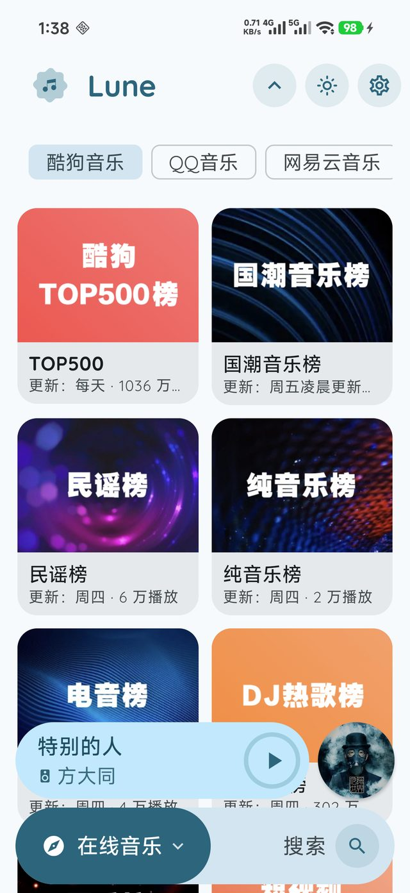
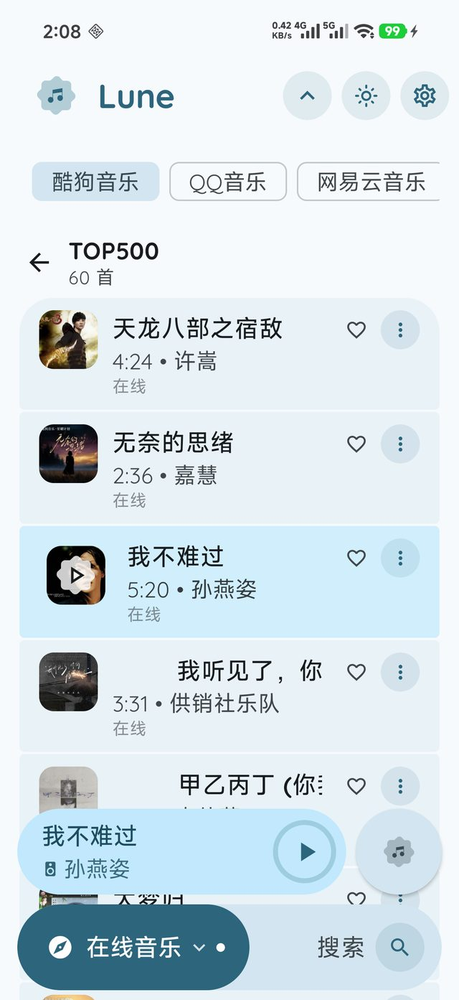
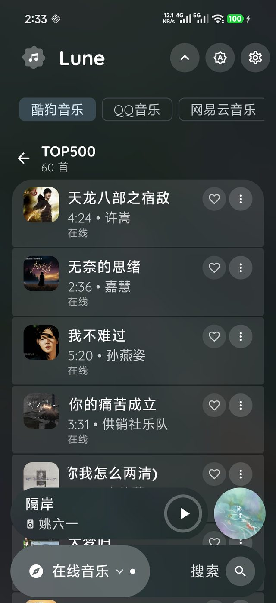
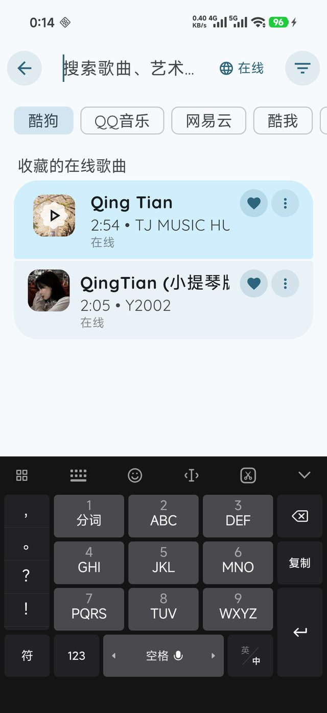
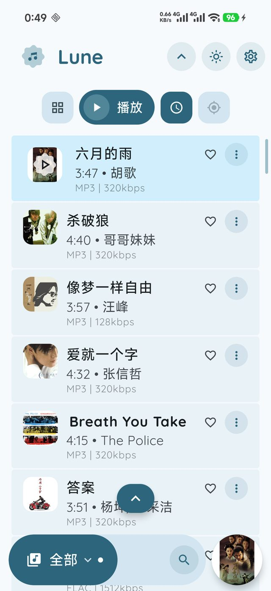

# LuneLX

> 一个 **本地 + 在线** 双模的 Android 音乐播放器。
> 本地侧是完整的媒体库体验；在线侧通过 [lx-music](https://github.com/lyswhut/lx-music-mobile) 兼容的**音源脚本**取流，
> 并由客户端内置各平台的搜索 / 歌词 / 榜单接口。

<p align="left">
  
  
  
  
  
</p>

> **本项目是 [Lune](https://github.com/MrDemonc/Lune)（GPL-3.0）的衍生版**（详见 [NOTICE.md](NOTICE.md)），
> 在原版本地播放的基础上补齐了一条完整的在线链路：音源脚本沙箱、五平台搜索、内置歌词、
> 在线下载（写封面/歌词标签）、在线收藏、平台榜单发现。
> 本仓库不托管、不存储、不提供任何音频内容。

---

## 截图

| 在线音乐 · 平台发现 | 榜单歌曲（可播放/收藏/下载） |
|---|---|
|  |  |

| 深色模式 | 收藏的在线歌曲 | 定位到正在播放 |
|---|---|---|
|  |  |  |

---

## 功能

### 本地音乐
- 扫描 MP3 / FLAC / WAV / AAC / M4A / OGG / OPUS / WMA / ALAC / DSF / DFF，读内嵌标签与高解析度信息（采样率/位深）
- 专辑 / 艺术家 / 流派 / 文件夹 / 收藏 / 歌单，全部支持搜索与排序
- 播放统计（歌曲/歌手/流派/歌单）、首页「继续收听」与 Top 榜
- 元数据编辑（标题/歌手/专辑/流派/自定义封面）、歌词编辑与 `.lrc` 导入导出
- 播放列表备份 / 恢复

### 播放
- Media3 ExoPlayer，独立 `audioSessionId`，音效链：均衡器 / 低音增强 / 环绕 / 混响 / 响度 / 动态处理
- 播放速度、音高、432Hz 调音、睡眠定时、无缝循环、随机与循环模式
- 系统媒体会话（通知栏 / 锁屏 / 蓝牙 / 车机）、桌面小部件、可视化频谱
- 播放状态恢复：重开 App 回到上次那首，但**保持暂停**

### 在线音乐（可选，需自行导入音源脚本）
- **音源脚本**：QuickJS 沙箱运行 lx-music 兼容脚本，可导入 / 启用 / 删除，多脚本互不干扰
- **内置五平台搜索**：酷狗 / QQ音乐 / 网易云 / 酷我 / 咪咕 —— 搜索是客户端做的，脚本只负责把 `songmid` 换成直链
- **内置歌词**：网易云（含翻译）/ QQ / 酷狗 / 咪咕
- **本地流代理**：统一处理防盗链 Referer/Cookie、`http→https` 跨协议重定向、直链过期 403 重解析
- **在线下载**：落到 `Music/Lune/`，并**写入封面（APIC）与歌词（USLT）**，脱离本 App 也能显示
- **在线收藏**：收藏后把整首歌曲快照存进 Room，重启后仍能在「收藏的在线歌曲」里找到并播放
- **平台发现**：酷狗 / QQ / 网易云的官方榜单（榜单列表 → 榜单歌曲），平台标签收纳在顶部一行
- **混合队列**：本地歌与在线歌可混排，队列跨重启完整恢复

### 界面
- Material 3 + 动态取色，深色模式，毛玻璃（blur）背景
- 自定义封面形状 / 尺寸 / 旋转 / 黑胶效果，自定义控件颜色与图标风格
- 搜索页内「本地 ⇄ 在线」切换，模式记忆；分区可自定义显隐与默认页
- 手势：播放页左滑进歌词、歌词页右滑返回（可开关）

---

## 快速开始

**要求**：Android 8.0（API 26）及以上。

1. 从 [Releases](../../releases) 下载 APK 安装（或自行构建，见下）。
2. 首次启动授予「音频/媒体」权限，App 会扫描本地音乐。
3. 想听在线音乐：
   - 打开 **设置 → 通用 → 音源**，从文件或 URL 导入一个 lx-music 兼容的音源脚本（`.js`）并启用；
   - 回到 **搜索**，把右上角切到「在线」；或进入 **在线音乐** 分区看平台榜单。

> 在线功能默认关闭，只有导入并启用脚本后才会出现。脚本由第三方提供，请只使用你信任的来源。

---

## 构建

环境：**JDK 21** + **Android SDK 37**（compileSdk 37 / targetSdk 37 / minSdk 26），AGP 9.4、Gradle 9.7.1（wrapper 自带）。

```bash
# 调试包
./gradlew :app:assembleDebug

# 单元测试（34 个：uid 规则、统计 key、歌词文件 key、脚本探测、WAV 元数据等）
./gradlew :app:testDebugUnitTest

# 脚本桥接层回归测试（不需要 Android 工具链）
node tools/preload-check.js          # 期望 6/6 通过
```

产物：`app/build/outputs/apk/debug/Lune-debug.apk`。

> 小提示：如果你的项目路径或用户名含中文，AGP 会拒绝构建
> （`Your project path contains non-ASCII characters`）。在 **Gradle 用户目录**的
> `gradle.properties` 里加一行 `android.overridePathCheck=true` 即可，不必改项目自己的配置。

---

## 架构速览

```
app/src/main/java/com/lunelx/music/
├── lx/                    在线音源子系统
│   ├── engine/            QuickJS 沙箱、脚本加载、user-api 桥、cookie 存储
│   ├── search/            内置五平台搜索 / 四平台歌词（客户端直连平台接口）
│   ├── discover/          平台「发现」：官方榜单 + 榜单歌曲
│   ├── net/               本地流代理（防盗链、重定向、Range、403 重解析）
│   ├── download/          在线下载 + 封面/歌词标签注入
│   ├── store/             脚本导入、启用状态、在线总开关
│   └── LxRepository.kt    统一入口：搜索 → 直链 → 播放地址
├── tools/                 本地音乐核心
│   ├── PlaybackManager    播放状态机、队列、统计、收藏
│   ├── MusicService       前台服务、MediaSession、音效链、通知
│   ├── ExoPlayerWrapper   把 ExoPlayer 适配成 MediaPlayer 形状（沿用原版调用点）
│   ├── MusicProvider      MediaStore 扫描 + 缓存
│   └── SongUid / SongJson uid 规则、Song 快照序列化
├── data/                  Room 3（uid 主键 + 迁移）、歌单、播放统计
└── ui/                    Compose：首页、列表、详情、搜索、歌词、播放器、设置
```

三个关键设计（都是踩过坑之后定下来的）：

1. **一切按 `uid` 索引**。本地是 `local:<MediaStoreId>`，在线是 `lx:<source>:<songmid>`。
   在线歌曲的 `id` 恒为 `0`，早期用 `id` 当 key 导致「收藏一首=收藏全部」「统计堆进同一行」「封面互相串」。
2. **在线歌曲是"易失对象"**。它不在 MediaStore 里，进程一退出就没了。所以收藏 / 统计 / 队列
   都会把整首 `Song` 序列化成 JSON 存进 Room（`meta` 列），重启后按 uid 重建。
3. **播放永远经过本地流代理**。脚本给出的直链需要特定 Referer/Cookie、还会 `http→https` 跳转、
   几十分钟后失效；代理把这些统一处理掉，ExoPlayer 只认 `http://127.0.0.1:<port>/stream/<token>`。

---

## 已知限制

- **酷我 / 咪咕的「发现」暂无数据**：两家榜单接口要登录态（酷我匿名返回 `The request is illegal!`，
  咪咕返回「路由请求不支持」）。UI 会提示并给出「去搜索」。
- **酷我歌词**：三个歌词入口均已被封，需要换数据源。
- **在线歌暂不能加入播放列表**：`playlist_songs` 仍按 MediaStore id 存，在线歌会互相顶掉，
  所以对在线歌暂时隐藏了「加入播放列表」。
- 下载没有进度/队列/续传，只有转圈与完成提示。
- 在线播放偶发「没声但状态仍是播放中」：已加看护（位置 6 秒不动 → 重解析直链并 seek；
  再不动 → 跳下一首），根因（上游连接空闲超时）仍在跟进。

---

## 免责声明

- 本项目**不提供、不托管、不存储**任何音频内容，也不内置任何音源脚本。
- 在线播放依赖**用户自行导入**的第三方音源脚本，其行为与合法性由脚本作者与使用者负责。
- 内置的搜索 / 歌词 / 榜单只是对各平台**公开接口**的调用；音频版权归各平台与版权方所有。
- 本项目与任何音乐平台无从属关系，也未获其背书。**仅供个人学习与研究，请支持正版。**

---

## 许可与致谢

本项目以 **GNU GPL-3.0** 发布，见 [LICENSE](LICENSE)。作为衍生作品，上游版权与声明保留在 [NOTICE.md](NOTICE.md) 中。

- [Lune](https://github.com/MrDemonc/Lune) —— 基础播放器（本地扫描 / 音效 / Widget / UI），GPL-3.0
- [PixelPlayerOLX](https://github.com/MiNoMinoaa/PixelPlayerOLX) —— `LxScriptEngine` 的实现参考，GPL-3.0
- [lx-music-mobile](https://github.com/lyswhut/lx-music-mobile) —— 音源脚本 API 规范与 `user-api-preload.js` 桥接层，Apache-2.0
- [QuickJS Android wrapper](https://github.com/HarlonWang/quickjs-android-wrapper) —— JS 沙箱，MIT
- 以及 AndroidX Media3、Jetpack Compose、Coil、jaudiotagger、OkHttp、Gson

更细的定位过程与逐条验证记录见 [docs/AUDIT-REPORT.md](docs/AUDIT-REPORT.md)，
日常开发与踩坑笔记见 [docs/开发笔记.md](docs/开发笔记.md)。
